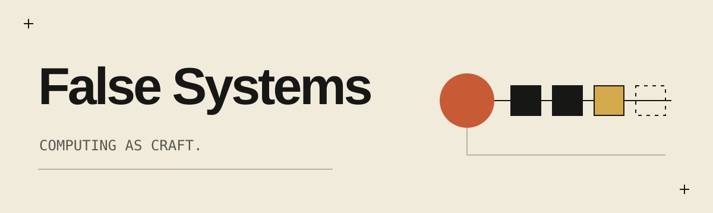
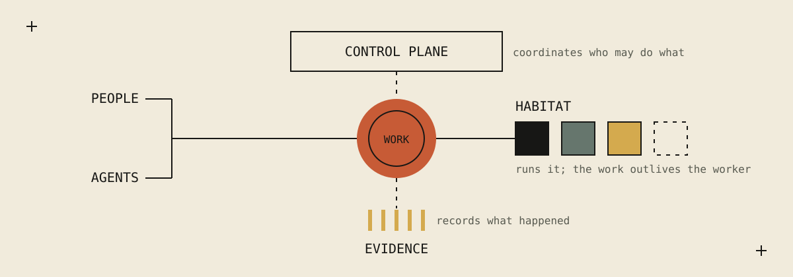
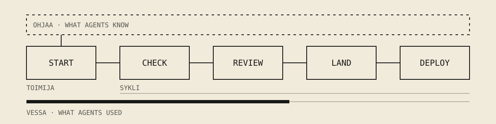

**Delegate more. Move faster. Keep control.**

People and AI agents now work on the same tasks. The work crosses tools:
a request becomes an agent session, a commit, a test run, a credential, a
deployment. Each tool sees its own part, and the thread between the request,
the permission to act and the result gets lost. False Systems builds the
infrastructure that keeps that thread: one control plane for humans, AI agents
and infrastructure.

[false-systems.com](https://false-systems.com) ·
[Manifesto](https://false-systems.com/manifesto.html) ·
[Talk with us](https://false-systems.com/about.html)

## What we build

| | |
|---|---|
| [**Control Plane**](https://false-systems.com/control-plane.html) | Coordinates. Defines how work happens in your organisation: who takes part, who may decide, and what done means, for people and agents alike. |
| [**Habitat**](https://false-systems.com/habitat.html) | Executes. Runs the work locally, remotely or inside your infrastructure. The work keeps its permissions, history and results when a worker stops or is replaced. |
| [**Evidence**](https://false-systems.com/evidence.html) | Establishes. A checkable account of what happened, separate from the agent's own story, that keeps what was observed apart from what was inferred. |

## Open tools for working with coding agents

Four small command-line tools, free and MIT licensed. Each one works alone.
Together they take a change from an agent's first prompt to production:
checked, reviewed by a second agent, landed and deployed, with no server and
no pull request required.

| Tool | What it does |
|---|---|
| [**toimija**](https://github.com/false-systems/toimija) | Starts an agent with the facts of the repository, and shows who is working where. |
| [**sykli**](https://github.com/false-systems/sykli) | Runs the checks you declare and keeps proof. A second agent reviews the change; sykli lands and deploys only what is proven. |
| [**ohjaa**](https://github.com/false-systems/ohjaa) | Holds what your agents are told: decisions, lessons, facts. Anyone can propose; a person decides. |
| [**vessa**](https://github.com/false-systems/vessa) | Counts what your agents used, from the records they leave on disk. Numbers only, never prices; shared with your team through git. |

They work with Claude Code, Codex, pi and opencode, on macOS and Linux. sykli
and vessa also run on Windows; toimija and ohjaa run there under WSL.

**Start with [Your first loop](https://github.com/false-systems/toimija/blob/main/docs/first-loop.md)**:
one change, through all four tools.

## What we hold to

- **Independent.** The witness sits outside the agent. An agent never judges
  its own change, and its own account is not the record.
- **Honest.** Partial stays visibly partial. What could not be read is unknown,
  never zero.
- **Portable.** Your work, rules and records belong to you, not to an agent
  vendor or to us.

## Also open

Not everything here is part of a product. Some of it solves a problem cleanly
enough to stand alone, and is published for that reason.

- [jälki](https://github.com/false-systems/jalki): ask the Linux kernel what went wrong, with eBPF probes.
- [syvä](https://github.com/false-systems/syva): node-local eBPF enforcement that isolates workload zones. Experimental.
- [rauta](https://github.com/false-systems/rauta): a Kubernetes API gateway in Rust.
- [false-agent-protocol](https://github.com/false-systems/false-agent-protocol): versioned contracts between the tools.

## Status

Early. Interfaces change. Ask before you build on anything here; the four
tools for coding agents are the most settled.

False Systems · Berlin — Helsinki · computing as craft
